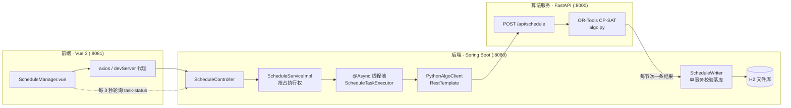
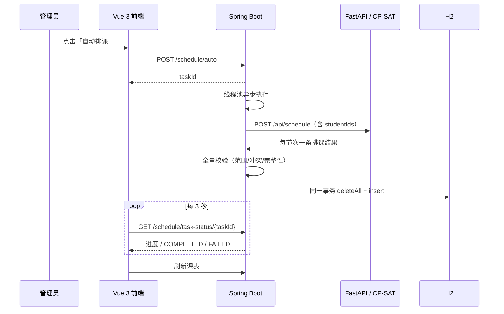

# lams-schedule · 实验室自动排课系统

一个把「自动排课」这条链路完整跑通的最小可运行项目：前端发起任务，后端异步编排，Python 侧的 OR-Tools CP-SAT 求解，结果在单个数据库事务内校验并落库，前端轮询进度并刷新课表。

> 本项目由一套完整的实验室管理系统裁剪而来，只保留登录、课程/实验室维护、课表查看与自动排课。实验报告、成绩、预约、设备报修、资料上传、OSS、Redis、微信支付等模块均已移除，**未在本文档中描述的能力即为不存在的能力**。

## 项目背景与解决的问题

实验室排课需要同时满足：每门课每周固定连续节次、同一实验室同一时段只能有一门课、教室容量足够、以及**同一名学生不能在同一时段被安排两门课**。人工排表在课程/实验室数量上升后极易冲突且难以验证。

本项目把这些条件建模为 CP-SAT 约束，由求解器给出可行解；求解结果在写入数据库前再做一次独立校验，任一条不合法就整体回滚，避免脏课表覆盖旧课表。它适合用来演示「前端 → 异步任务 → 算法服务 → 事务落库」这一整套工程链路。

## 核心功能

| 功能 | 说明 |
| --- | --- |
| 自动排课 | 管理员一键触发，异步执行，进度条轮询，成功/失败均有反馈 |
| 学生不撞课 | 后端下传选课名单，求解器对同一学生所选课程加时段互斥（跨实验室同样生效） |
| 结果防御性校验 | 周次/星期/节次范围、实验室与课程存在性、时段冲突、每门课总节数完整性 |
| 课表查看 | 管理员按周查看全量课表；学生只看到自己所选课程 |
| 基础维护 | 课程、实验室的增删改查；登录与 JWT 鉴权 |
| 无解诊断 | 容量不足或约束冲突时返回中文诊断信息并展示到前端 |

## 技术栈

| 层 | 技术 | 版本 / 说明 |
| --- | --- | --- |
| 前端 | Vue 3、Element Plus、vue-router、axios、Vue CLI 5 | 实测 Node 22.22.2 / npm 10.9.7 |
| 后端 | Spring Boot 2.7.3、MyBatis、Druid、H2、jjwt 0.9.1、Lombok | 实测 JDK 17.0.10 / Maven 3.9.9 |
| 算法 | Python、FastAPI、uvicorn、OR-Tools CP-SAT | 实测 Python 3.13.7，依赖见 `algo/requirements.txt` |
| 数据库 | H2 文件库（5 张表） | 无需独立数据库服务 |
| CI | GitHub Actions（`.github/workflows/ci.yml`） | `main` 分支 push / PR 触发三个测试 job |

## 系统架构



## 核心业务流程



关键设计：`ScheduleWriter.replaceAll()` 在**同一个事务**里先完成全量校验，再 `deleteAll` 与逐条 `insert`；任一条非法或课程节数不完整即整体回滚，旧课表保持不变。任务无论成功或失败都会在 `finally` 中归还执行权，因此可以连续排课。

## 目录结构

```
srp_schedule/
├─ .github/workflows/ci.yml      CI：后端 / 算法 / 前端三个测试 job
├─ .env.example                  环境变量清单（不含任何真实密钥）
├─ .gitignore                    统一忽略依赖、构建产物、本地数据
├─ LICENSE                       MIT
├─ README.md
├─ docs/
│  ├─ ARCHITECTURE.md            架构、数据模型与约束模型
│  ├─ DEPLOYMENT.md              部署、配置与常见问题
│  └─ API.md                     接口清单
├─ algo/                        FastAPI + CP-SAT 求解服务 (:8000)
│  ├─ main.py                    POST /api/schedule、GET /health
│  ├─ algo.py                    约束建模与求解
│  ├─ requirements.txt           实测锁定的顶层依赖
│  ├─ _smoke.py                  手工冒烟脚本
│  └─ test_algo.py               9 项约束断言（unittest）
├─ backend/                     Spring Boot (:8080)
│  ├─ pom.xml
│  ├─ src/main/java/org/example/
│  │  ├─ lamscommon/             Result / 常量 / JWT / 线程上下文
│  │  ├─ lamspojo/               DTO / PO / VO
│  │  └─ lamsserver/             controller / service / mapper / schedule / config
│  ├─ src/main/resources/        application.yml、schema.sql
│  └─ src/test/java/...          ScheduleTaskExecutorTest（4 项）
└─ frontend/                    Vue 3 (:8081)
   ├─ src/api/index.js           axios 接口封装
   ├─ src/router/index.js        路由与角色守卫
   ├─ src/views/                 7 个页面
   ├─ vue.config.js              devServer 端口与代理
   └─ package-lock.json          依赖锁定
```

## 环境依赖

| 组件 | 要求 | 本机实测 |
| --- | --- | --- |
| JDK | 17 | 17.0.10 |
| Maven | 3.9+ | 3.9.9 |
| Node.js | 18+ | 22.22.2 |
| Python | 3.10+（CI 使用 3.13） | 3.13.7 |

## 数据库初始化

无需手工建库。`application.yml` 中 `spring.sql.init.mode=always`，后端每次启动都会执行 `backend/src/main/resources/schema.sql`（全部 `IF NOT EXISTS`，幂等），创建 5 张表：

| 表 | 作用 |
| --- | --- |
| `users` | 账号，`user_type` 为 `admin` / `student`，密码 BCrypt 存储 |
| `laboratories` | 实验室，`capacity` 参与容量约束 |
| `courses` | 课程，`weeks`（周数）、`periods`（每周节数）是排课输入 |
| `course_students` | 选课关系，决定学生可见课表，也是「学生不撞课」约束的输入 |
| `schedules` | 排课结果，`(week, day, section, lab_id)` 唯一 |

`DataInitializer` 只在表为空时写入演示数据：3 个账号、4 间实验室、4 门课程，且两名学生选了全部课程。数据库文件位于 `backend/data/lamsdb.mv.db`，该目录已被忽略、不会提交。

> H2 2.x 把 `DAY` 当保留字，连接串里加了 `NON_KEYWORDS=DAY,WEEK,VALUE`。

## 配置说明

| 配置项 | 位置 | 默认值 |
| --- | --- | --- |
| `server.port` | `application.yml` | `8080` |
| `spring.datasource` | `application.yml` | H2 文件库，`sa` / 空密码 |
| `lams.jwt.secret-key` | `application.yml` | `${LAMS_JWT_SECRET:演示密钥}` |
| `lams.jwt.ttl` | `application.yml` | `86400000`（24 小时） |
| `lams.cors.allowed-origins` | `application.yml` | `localhost:8081` 等本地地址 |
| `lams.schedule.algo-url` | `application.yml` | `http://localhost:8000/api/schedule` |
| `lams.schedule.timeout-ms` | `application.yml` | `180000`（需大于算法侧 60s 求解上限） |
| `spring.h2.console.enabled` | `application.yml` | `true`（仅本地开发） |
| `devServer.port` / 代理 | `vue.config.js` | `8081`，代理到 `8080` |

**安全提示**：`LAMS_JWT_SECRET` 是唯一需要设置的环境变量，变量名清单见 `.env.example`。本项目**不会自动加载 `.env` 文件**，请用 shell 设置系统环境变量：

```powershell
$env:LAMS_JWT_SECRET = "替换为随机长字符串"
```

若未设置，后端会使用 `application.yml` 里的演示密钥——只适合本地开发；任何对外部署都必须覆盖它，否则任何人都能签发管理员令牌。同时请关闭 `spring.h2.console.enabled`（该路径在 JWT 拦截器白名单内，且 H2 使用 `sa` / 空密码）。

## 本地启动（三个终端）

### 1. 算法服务（先启动，:8000）

```powershell
cd srp_schedule\algo
python -m venv .venv
.\.venv\Scripts\python.exe -m pip install -r requirements.txt
.\.venv\Scripts\python.exe -m uvicorn main:app --host 127.0.0.1 --port 8000
```

健康检查：`http://127.0.0.1:8000/health` 返回 `{"status":"ok"}`；交互式 API 文档在 `http://127.0.0.1:8000/docs`。

### 2. 后端（:8080）

```powershell
cd srp_schedule\backend
mvn -DskipTests spring-boot:run
```

数据库控制台：`http://127.0.0.1:8080/h2-console`，JDBC URL `jdbc:h2:file:./data/lamsdb`，用户 `sa`，密码空。

### 3. 前端（:8081）

```powershell
cd srp_schedule\frontend
npm install
npm run serve
```

打开 `http://localhost:8081/`。

### 演示账号

| 身份 | 用户名 | 密码 | 可见功能 |
| --- | --- | --- | --- |
| 管理员 | `admin` | `123456` | 课表与排课、课程管理、实验室管理 |
| 学生 | `student1` / `student2` | `123456` | 查看本人课表 |

**以上为虚构演示账号，请勿在任何对外环境沿用。**

## API 文档

- 算法服务：FastAPI 自动生成，启动后访问 `http://127.0.0.1:8000/docs`（已实测返回 200）。`POST /api/schedule` 的课程对象里 `studentIds` 为**必填**，缺失返回 422。
- 后端 REST 接口：完整清单见 [`docs/API.md`](docs/API.md)。Spring Boot 侧未集成 Swagger/OpenAPI，接口以该文档与 `src/api/index.js` 为准。
- 统一响应结构：`{ "code": 0, "msg": null, "data": ..., "timestamp": ... }`，`code != 0` 表示业务失败。

## 验证

```powershell
# 算法（9 项）
cd srp_schedule\algo
.\.venv\Scripts\python.exe -m unittest test_algo -v
.\.venv\Scripts\python.exe _smoke.py

# 后端（4 项）
cd srp_schedule\backend
mvn -B test

# 前端
cd srp_schedule\frontend
npm run lint
npm run build
```

`test_algo.py` 覆盖：结果条数完整、连续节次、实验室容量、同一实验室时段互斥、**同一学生不撞课**、同周冲突组分散、独立学生组可并行、非法输入、无解诊断与 `studentIds` 契约。
`ScheduleTaskExecutorTest` 覆盖：成功/失败后都归还执行权（防止「第二次无法排课」回归）、任务满额淘汰最旧、更新已有任务不误删。

CI 工作流在 `main` 分支的 push 与 PR 上分别运行后端 `mvn -B test`、算法 `python -m unittest test_algo -v`、前端 `npm ci` + `npm run lint` + `npm run build`。

## 已验证结果（Windows 本机，2026-11-08）

| 检查 | 结果 |
| --- | --- |
| `mvn -B test` | BUILD SUCCESS，4 tests / 0 failures |
| `python -m unittest test_algo -v` | 9 tests OK（1.47s） |
| `python -m compileall`（4 个源码文件） | 通过 |
| `npm run lint` | No lint errors found |
| `npm run build` | Build complete（113.9s）；有 1.39 MiB bundle 体积警告，非失败 |
| 三端启动探活 | 前端 `/` 200；算法 `/health` 200、`/docs` 200；后端登录 `code=0`、无 token 接口 401 |
| 端到端自动排课 | `COMPLETED` / 100% / 60 条记录；紧接着再次提交也成功 |

> 说明：`python -m venv` / `pip install -r` 与 `npm install` 这三个依赖安装命令**未在本机重新执行**（本机已有 `.venv` 与 `node_modules`）；其余启动命令均按上文实际跑通。在本机受限沙箱中首次启动后端时被注入了随机端口导致端口占用，显式指定 `--server.port=8080` 后正常启动——这是运行环境差异，不是项目缺陷。

## 运行截图

仓库内暂无截图文件，因此本节不放示意图片。欢迎在熟悉系统后补充真实截图到 `docs/` 并在本节引用。

## 已知问题与后续计划

**已知限制（现状，非待办承诺）**

- H2 为单机文件库，任务状态存于 JVM 内存，后端重启后任务进度丢失；均不适合多实例部署。
- 求解目标偏向「尽量靠前」，有共同学生的课程会被分散到不同星期；冲突组内课程数超过 7 时不再强制分散，仅靠学生互斥保证不撞课。
- H2 控制台默认开启、演示 JWT 密钥存在默认值、演示账号为弱密码：仅适用于本地开发，部署前必须按「配置说明」加固。
- `frontend/package-lock.json` 的 `resolved` 指向 `registry.npmmirror.com`，海外 CI 首次安装可能较慢。
- 前端生产构建有 chunk 体积警告（Element Plus 全量引入），未做按需加载优化。
- 无 Dockerfile / Compose 编排，无自动化端到端测试，无 Swagger 文档（后端）。

**后续可考虑（均未实现）**：容器化一键启动、任务状态持久化、后端 OpenAPI 文档、前端按需加载与截图补充。

## License

[MIT](LICENSE) © 2026 fxger
