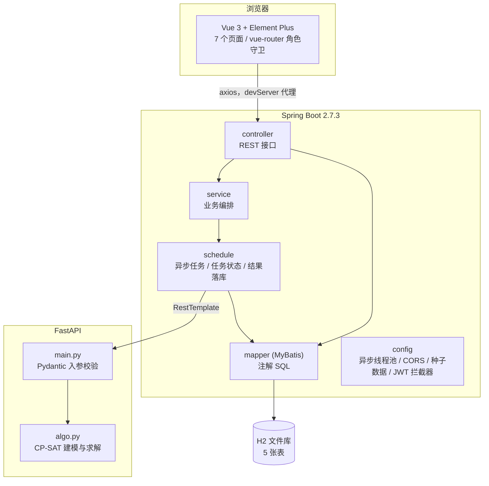
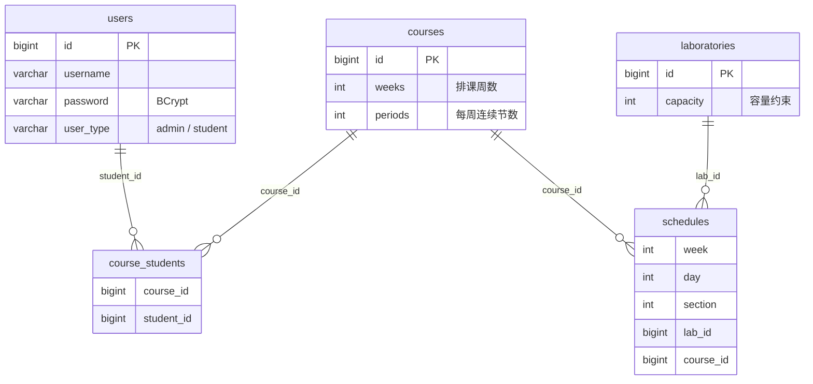

# 架构说明

## 分层与职责

| 层 | 入口 | 职责 |
| --- | --- | --- |
| 前端 | `frontend/src/main.js` | 登录、课程/实验室维护、课表展示、排课触发与进度轮询 |
| 后端 | `LamsServerApplication` | JWT 鉴权、CRUD、排课任务编排、求解结果校验与事务落库 |
| 算法 | `algo/main.py:app` | 只做一件事：接收课程与实验室，返回每个节次一条排课结果 |
| 存储 | `backend/data/lamsdb.mv.db` | H2 文件库，无需独立服务 |

前端不直接调用算法服务；所有请求经 `vue.config.js` 代理到后端 `8080`，由后端用 `RestTemplate` 转发到算法服务 `8000`。

## 数据模型

`schedules` 上有唯一索引 `(week, day, section, lab_id)` 作为数据库层兜底。`course_students` 既决定学生能看到哪些课，也是求解器「学生不撞课」约束的数据来源。

## 排课约束模型（CP-SAT）

变量 `x[(courseId, week, day, startSection, labId)]` 为布尔值，表示「该课程在第 week 周、第 day 天、从 startSection 开始连续上 `sessionsPerWeek` 节，占用某实验室」。

| 约束 | 内容 |
| --- | --- |
| 每周恰好一次 | 每门课每周用 `AddExactlyOne` 选一个连续块（固定同一天、同一实验室） |
| A 实验室互斥 | 同一 `(week, day, section, lab)` 最多一个占用 |
| B 学生互斥 | 对每个学生，其所有选课在同一 `(week, day, section)` 最多一个占用；跨实验室同样生效，同时覆盖「同一门课不占两个位置」 |
| C 星期分散 | 用并查集把共享学生的课程归为冲突组，组内课程数 ≤ 7 时对每周的 `day` 变量加 `AddAllDifferent`；学生群体互不重叠的组仍可同天并行 |
| 容量 | 只为该课程生成 `capacity >= studentCount` 的实验室变量 |
| 目标 | `Minimize Σ var × ((day-1)×11 + start)`，在满足约束的前提下尽量靠前 |

建模前按 `(week, day, section)` 预索引占用关系，避免逐格遍历全部变量（旧实现约 8400 万次 Python 迭代，实测耗时从 4.79s 降到 0.96s）。无解时返回中文诊断（容量 / 单周需求 / 学生负载），由后端透传到前端。

## 事务与并发

1. `ScheduleServiceImpl.autoSchedule()` 用 `ScheduleTaskStore.tryAcquire()` 的原子布尔锁抢占执行权，同一时刻只允许一个排课任务，返回 `taskId`。
2. `ScheduleTaskExecutor.execute()` 标注 `@Async("scheduleExecutor")`，在独立线程池中执行：调用算法服务 → 提交结果给 `ScheduleWriter`。
3. `ScheduleWriter.replaceAll()` 在**同一事务**内先做全量校验（范围、存在性、时段冲突、每门课 `weeks × periods` 完整性），全部通过后才 `deleteAll` + 逐条 `insert`；任何失败整体回滚，旧课表保持不变。
4. 任务无论成功、失败还是异常，都在 `finally` 中 `release()` 归还执行权；线程池直接拒绝提交时由 `autoSchedule()` 兜底释放。
5. 任务状态（10% → 30% → 70% → 100%）存在内存 `ConcurrentHashMap`，按单调序号淘汰最旧任务；前端每 3 秒轮询 `GET /schedule/task-status/{taskId}`。

## 认证

`JwtTokenInterceptor` 拦截除 `/auth/login`、`/error`、`/h2-console/**` 以外的请求，校验 `Authorization: Bearer <token>`，把 `id / username / role` 写入 `BaseContext` 的 ThreadLocal，并在 `afterCompletion` 中清理。密码用 BCrypt 存储。拦截器只记录用户 id / 用户名 / 角色，不记录 token 原文。

## 设计取舍

- **为什么单独起一个 Python 服务**：OR-Tools 在 JVM 侧没有同等易用的 CP-SAT 绑定，拆成独立服务也让求解超时与重试边界更清晰。
- **为什么求解结果还要再校验一次**：算法服务是独立进程，后端不能信任其输出；事务内校验保证「要么完整替换，要么保持原样」。
- **为什么任务状态放内存**：排课任务是短生命周期操作，重启后进度丢失可接受，避免为演示项目引入额外中间件。
